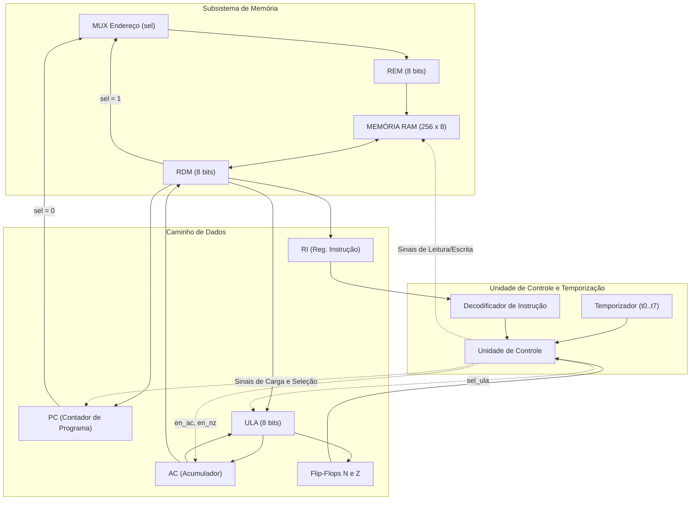

# O Computador Neander: Arquitetura, Organização e Implementação em Verilog

> **Disciplina:** Circuitos Digitais (INF01058)  
> **Instituição:** Instituto de Informática — Universidade Federal do Rio Grande do Sul (INF - UFRGS)  
> **Linguagem de Descrição de Hardware:** Verilog HDL  
> **Ferramentas:** Altera / Intel Quartus II, ModelSim

---

## 1. O que é o Neander? (Explicação para Pessoas Leigas)

Imagine que você quer entender como funciona o motor de um carro de Fórmula 1 moderno. Ele possui milhares de peças eletrônicas, sensores complexos e computadores de bordo que tornam quase impossível entender o funcionamento básico logo de início. No entanto, se você olhar para o motor de uma **bicicleta motorizada** simples ou de um cortador de grama, você consegue enxergar perfeitamente o pistão, a vela e a engrenagem trabalhando juntos.

O **Neander** é exatamente essa "bicicleta com motor" do mundo dos computadores. 

O nome **Neander** é uma brincadeira com o *Homem de Neandertal* (o ancestral pré-histórico da humanidade). Ele foi criado por professores do **Instituto de Informática da UFRGS** (notadamente o Prof. Raul Fernando Weber) com um objetivo nobre: **ser o computador mais simples e primitivo possível, mas que ainda seja 100% capaz de executar programas reais**.

### A Analogia da Cozinha / Escritório:
Para entender como ele funciona por dentro, pense no Neander como um cozinheiro em uma bancada organizada:

1. **A Memória (`Memoria.v`):** É uma estante com **256 gavetas numeradas** (de 0 a 255). Dentro de cada gaveta, há um bilhete com um número de 8 dígitos binários (zeros e uns). Esses bilhetes podem ser ordens da receita (instruções) ou ingredientes (dados numéricos).
2. **O Apontador de Programa (`PC` — *Program Counter*):** É o dedo do cozinheiro apontando para a gaveta atual da receita: *"Agora estou lendo a gaveta 10... terminei, agora vou para a gaveta 11"*.
3. **O Acumulador (`AC` — *Accumulator*):** É a tigela de mistura em cima da bancada. Qualquer ingrediente novo é jogado e misturado nela. Se você quer somar $5 + 3$, você coloca $5$ na tigela, depois traz o $3$ e mistura; a tigela passa a conter $8$.
4. **A ULA (`ULA8.v` — Unidade Lógica e Aritmética):** É a calculadora de bolso do cozinheiro, capaz de somar, inverter sinais ou comparar valores.
5. **As Flags de Condição ($N$ e $Z$):** São duas luzinhas indicadoras:
   - Luz **Z (Zero):** Acende se o conteúdo da tigela for igual a zero.
   - Luz **N (Negativo):** Acende se o resultado for um número negativo.
   Essas luzes permitem ao cozinheiro tomar decisões: *"Se a luz Z acendeu, pule para o final da receita"*.
6. **A Unidade de Controle (`Controle.v`) e Temporizador (`Temporizador.v`):** É o cérebro e o metrônomo do cozinheiro. A cada batida do relógio (*clock*), ele dá uma ordem clara: *"abra a gaveta"*, *"leia o bilhete"*, *"ative a calculadora"*, *"guarde o resultado"*.

---

## 2. Visão Geral Acadêmica (Contexto INF - UFRGS)

Na disciplina de **Circuitos Digitais da UFRGS**, o projeto do Neander representa o **ápice do aprendizado prático**. Tudo o que foi desenvolvido isoladamente nos laboratórios anteriores converge aqui:

```
[LAB 1: Somador 1 bit] ----> [LAB 2: Somador RCA] ----> [LAB 3: Somador-Subtrator] 
                                                                  │
[LAB 4: Decodificadores & MUX] ─────────────────────────────────┤
                                                                  ▼
[LAB 6: Flags N e Z] ---------> [LAB 5 & 6: ULA Integrada] ───> [ PROJETO NEANDER ]
```

---

## 3. Especificações Técnicas da Arquitetura

- **Largura da Palavra de Dados:** 8 bits.
- **Largura do Barramento de Endereços:** 8 bits ($2^8 = 256$ posições de memória).
- **Representação Numérica:** Complemento a 2 com sinal (faixa de $-128$ a $+127$, ou $0$ a $255$ sem sinal).
- **Modelo de Arquitetura:** Máquina de acumulador único (arquitetura de Von Neumann — dados e instruções compartilham a mesma memória).
- **Registradores Internos:**
  - `AC` (8 bits): Acumulador de dados.
  - `PC` (8 bits): Contador de Programa (*Program Counter*).
  - `RI` (4 ou 8 bits): Registrador de Instrução (armazena o *opcode* da instrução em execução).
  - `REM` (8 bits): Registrador de Endereço de Memória.
  - `RDM` (8 bits): Registrador de Dados da Memória.
  - `N` e `Z` (1 bit cada): Flip-flops de código de condição.

---

## 4. Conjunto de Instruções do Neander (ISA)

O Neander possui um conjunto reduzido e elegante de 11 instruções essenciais:

| Código (*Opcode*) | Mnemônico | Formato | Operação Semântica (Nível RT) | Descrição em Português |
| :---: | :--- | :---: | :--- | :--- |
| `0000` | **NOP** | 1 byte | — | *No Operation*: Não faz nada, apenas avança o `PC`. |
| `0001` | **STA** *end* | 2 bytes | $\text{MEM}(end) \leftarrow AC$ | Armazena o valor do acumulador na memória. |
| `0010` | **LDA** *end* | 2 bytes | $AC \leftarrow \text{MEM}(end)$, atualiza $N, Z$ | Carrega um dado da memória para o acumulador. |
| `0011` | **ADD** *end* | 2 bytes | $AC \leftarrow AC + \text{MEM}(end)$, atualiza $N, Z$ | Soma o valor da memória ao acumulador. |
| `0100` | **OR** *end* | 2 bytes | $AC \leftarrow AC \lor \text{MEM}(end)$, atualiza $N, Z$ | Operação lógica OU bit a bit. |
| `0101` | **AND** *end* | 2 bytes | $AC \leftarrow AC \land \text{MEM}(end)$, atualiza $N, Z$ | Operação lógica E bit a bit. |
| `0110` | **NOT** | 1 byte | $AC \leftarrow \overline{AC}$, atualiza $N, Z$ | Inverte todos os bits do acumulador. |
| `1000` | **JMP** *end* | 2 bytes | $PC \leftarrow end$ | Desvio incondicional para o endereço especificado. |
| `1001` | **JN** *end* | 2 bytes | Se $N = 1$ então $PC \leftarrow end$ | Desvio condicional se o acumulador for negativo. |
| `1010` | **JZ** *end* | 2 bytes | Se $Z = 1$ então $PC \leftarrow end$ | Desvio condicional se o acumulador for zero. |
| `1111` | **HLT** | 1 byte | Para o processamento | Interrompe o clock e encerra a execução do programa. |

---

## 5. Diagrama em Blocos da Organização (*Datapath* e Controle)



---

## 6. O Ciclo de Instrução (Busca, Decodificação e Execução)

A cada instrução executada, o Neander divide seu trabalho em passos discretos de tempo sincronizados ($t_0$ a $t_7$), gerados pelo módulo `Temporizador.v`:

### 6.1 Fase de Busca (*Fetch*) — Comum a todas as instruções:
- **$t_0$:** $REM \leftarrow PC$ (prepara o endereço da memória apontado pelo $PC$).
- **$t_1$:** $\text{Read}$ (lê a memória); $PC \leftarrow PC + 1$ (avança o apontador para a próxima posição).
- **$t_2$:** $RI \leftarrow RDM$ (guarda o código da instrução no Registrador de Instrução).

### 6.2 Fase de Decodificação e Execução:
Dependendo do código presente no $RI$, a Unidade de Controle comanda os passos $t_3$ a $t_7$:
- **Instruções de 1 byte (ex.: `NOT`):** Executada rapidamente em $t_3$ com $AC \leftarrow \overline{AC}$, atualizando $N$ e $Z$, e emitindo `goto t0` imediatamente.
- **Instruções de 2 bytes (ex.: `ADD end`):**
  - $t_3$: $REM \leftarrow PC$ (busca onde está o endereço do operando).
  - $t_4$: $\text{Read}$; $PC \leftarrow PC + 1$ (lê o byte do endereço).
  - $t_5$: $REM \leftarrow RDM$ (prepara para buscar o dado real nesse endereço).
  - $t_6$: $\text{Read}$ (lê o dado numérico da memória).
  - $t_7$: $AC \leftarrow AC + RDM$; atualiza $N, Z$; `goto t0`.

---

## 7. Estrutura dos Arquivos em Verilog (`Neander/`)

| Arquivo | Descrição |
| :--- | :--- |
| `Neander.v` | **Módulo Top-Level:** Conecta todos os blocos do processador (*Datapath*, Unidade de Controle e Memória RAM). |
| `Controle.v` | **Unidade de Controle Combinacional:** Implementa as equações lógicas dos sinais de controle a partir do opcode no $RI$, temporização ($t_0..t_7$) e flags ($N, Z$). |
| `Temporizador.v` | **Gerador de Ciclos de Máquina:** Contador de 3 bits com decodificador 3:8 que gera os passos de tempo em anel *one-hot* ($t_0$ a $t_7$) com suporte a reinício antecipado (`goto`). |
| `ULA8.v` | **Unidade Lógica e Aritmética de 8 bits:** Realiza operações de soma, subtração, multiplicação, `AND`, `OR`, `NOT` e cálculo instantâneo das flags $N$ (MSB) e $Z$ ($S == 0$). |
| `SomadorSubtrator.v` | **Somador/Subtrator de 8 bits:** Operação combinacional de adição ou subtração em complemento a 2 com sinalizador de carry/borrow. |
| `mult.v` | **Multiplicador auxiliar:** Bloco multiplicador de 4 bits gerando saída de 8 bits para extensões aritméticas da ULA. |
| `mux8.v` | **Multiplexador 8 para 1 (8 bits):** Seleciona qual resultado de operação da ULA será roteado para a saída de acordo com o seletor `sel_ula`. |
| `PC.v` | **Program Counter:** Registrador de 8 bits com lógica síncrona de carga direta (para saltos `JMP`, `JN`, `JZ`) e incremento sequencial ($PC + 1$). |
| `REG8.v` | **Registrador Parametrizável com Habilitação:** Bloco síncrono reutilizado para o Acumulador (`AC`), registradores de interface com a memória (`REM`, `RDM`) e flags. |
| `Memoria.v` | **Memória RAM Síncrona:** Array de 256 posições de 8 bits (`reg [7:0] mem [0:255]`), com suporte a leitura e escrita síncronas. |
| `Neander.qpf` / `Neander.qsf` / `Neander.qws` | Arquivos de projeto e compilação do processador no Altera Quartus II. |

---

## 8. Considerações Finais

O processador **Neander** demonstra de forma transparente como portas lógicas elementares se combinam para dar vida à computação programável. Dominar a arquitetura Neander capacita o estudante de Ciência ou Engenharia da Computação a compreender não apenas este computador histórico, mas também as fundações de qualquer arquitetura moderna de microprocessadores (como x86, ARM e RISC-V).

